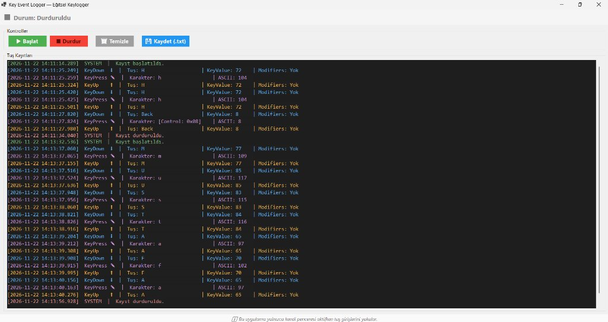
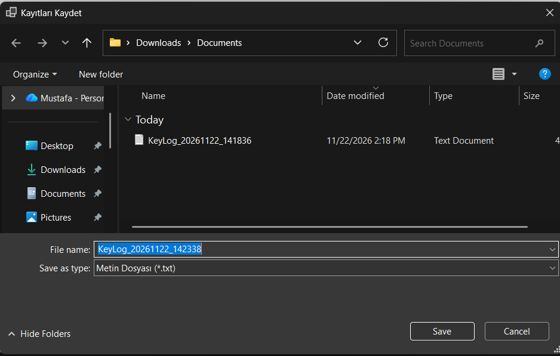

# ⌨️ Key Event Logger — Educational Keylogger

An educational keyboard event monitoring and analysis desktop application developed using **C#** and **.NET 10 Windows Forms**.  
The application demonstrates how keyboard events (`KeyDown`, `KeyUp`, and `KeyPress`) are captured, parsed, and handled inside an active desktop window, featuring real-time color-coded logging, recording lifecycle controls, and export capabilities to text files.

---

## 📌 Project Overview

This project was developed for educational purposes to illustrate event-driven programming and event message handling in Windows desktop applications. The application captures keyboard input **only while its own form window is active and in focus**, ensuring ethical use and full system safety.

Every key press is intercepted and decomposed into:
- Event type (`KeyDown`, `KeyUp`, `KeyPress`)
- Virtual key code (`KeyCode`)
- Numerical key representation (`KeyValue` / ASCII)
- Active keyboard modifiers (`Ctrl`, `Shift`, `Alt`)
- Millisecond-accurate timestamp (`[yyyy-MM-dd HH:mm:ss.fff]`)

---

## 📸 Screenshots

### 1. Real-Time Key Event Logging
The application actively recording key events with color-coded output, displaying timestamps, key codes, ASCII values, and modifier keys:



---

### 2. Export Logs to Text File (.txt)
The native Windows Save File Dialog allowing users to save recorded logs as a timestamped `.txt` document:



---

## 🚀 Core Features

- **Triple Keyboard Event Handling:**
  - `KeyDown ⬇`: Captures key press events with virtual key code (`KeyCode`), numeric code (`KeyValue`), and active modifiers.
  - `KeyPress ✎`: Captures printable character representation along with its decimal ASCII code.
  - `KeyUp ⬆`: Detects key release events to track complete press-and-release cycles.
- **Recording State Management:**
  - **▶ Start (Başlat):** Activates event logging.
  - **■ Stop (Durdur):** Pauses logging without clearing captured records.
  - **🗑 Clear (Temizle):** Resets and wipes the log display console.
  - **💾 Save (.txt) (Kaydet):** Prompts a `SaveFileDialog` to export logs via `StreamWriter` in UTF-8 encoding.
- **Visual Status Indicator:**
  - Dynamic circular indicator (● Green when actively logging, ● Gray when stopped).
  - Explicit textual status label (`Durum: Kayıt Yapılıyor...` / `Durum: Durduruldu`).
- **Color-Coded Dark Console:**
  - Customized `RichTextBox` styled as a dark developer console (`#1E1E1E`).
  - Distinct colors for each event category (Cyan/Blue for `KeyDown`, Orange for `KeyUp`, Purple for `KeyPress`, Green/Red for system state changes).
- **Form-Level Key Preview (`KeyPreview = true`):**
  - Intercepts all form keystrokes before child controls receive them.
  - Strictly sandboxed to the application window — **never logs keystrokes from other applications**.
- **Robust Exception Handling:**
  - Safeguarded file I/O operations with descriptive user dialog alerts on failure.

---

## 🛠️ Technologies Used & Dependencies

| Component | Description |
|---|---|
| **Target Framework** | .NET 10.0 Windows Desktop (`net10.0-windows`) |
| **Language** | C# (latest features: file-scoped namespaces, pattern matching, using declarations) |
| **GUI Framework** | Windows Forms (WinForms) |
| **I/O & Streams** | `System.IO.StreamWriter`, `System.IO.File` |
| **Event Architecture** | `KeyEventHandler`, `KeyPressEventHandler`, `KeyEventArgs`, `KeyPressEventArgs` |
| **NuGet Packages** | *None* — 100% built with standard .NET Base Class Libraries (BCL), keeping the application lightweight, fast, and dependency-free. |

---

## 📁 Repository Structure

```
KeyLogger/
├── .gitignore                      # Git ignore rules for .NET / Visual Studio
├── KeyEventLogger.slnx             # Visual Studio solution file (.NET 10)
├── README.md                       # Comprehensive English documentation
├── screenshots/
│   ├── key_event_logger_main.jpg   # Screenshot: Main event logger UI
│   └── save_dialog.png             # Screenshot: Save to file dialog
└── KeyEventLogger/
    ├── KeyEventLogger.csproj       # Project configuration (net10.0-windows)
    ├── Program.cs                  # Application bootstrap entry point
    ├── Form1.cs                    # Main form logic, UI building, and event handlers
    └── Form1.Designer.cs           # Designer generated code
```

---

## ⚙️ Installation & Running Steps

### Prerequisites
- Windows 10 or Windows 11
- [.NET 10 SDK](https://dotnet.microsoft.com/download/dotnet/10.0)

### 1. Clone the Repository
```bash
git clone https://github.com/mustafahaccar18-art/YMH219-KeyLogger.git
cd YMH219-KeyLogger
```

### 2. Build the Project
```bash
dotnet build
```

### 3. Run the Application
```bash
dotnet run --project KeyEventLogger
```

Alternatively, you can open `KeyEventLogger.slnx` in **Visual Studio 2022 / 2026** and press **F5**.

---

## ⚠️ Known Limitations & Development Notes

- **Application Focus Requirement:**  
  By design, keystroke capture operates via WinForms `KeyPreview = true`. Keystrokes are registered only when the application window holds active focus. Global OS-level hooks (`SetWindowsHookEx`) are intentionally omitted to comply with security best practices and ethical standards.
- **In-Memory Buffer:**  
  Logs reside in UI memory during runtime and are permanently stored only when manually exported through the **Kaydet (.txt)** feature.
- **Future Improvements:**  
  - Automated continuous auto-save intervals.
  - Export support for structured formats such as CSV and JSON.
  - Search and filter options by event type (`KeyDown` only, `KeyPress` only).

---

## 👤 Student Information

| Field | Detail |
|---|---|
| **Full Name** | Mustafa Haccar |
| **Student ID** | 250541623 |
| **Course** | YMH219 — Assignment #4 (Key Event Logger) |
